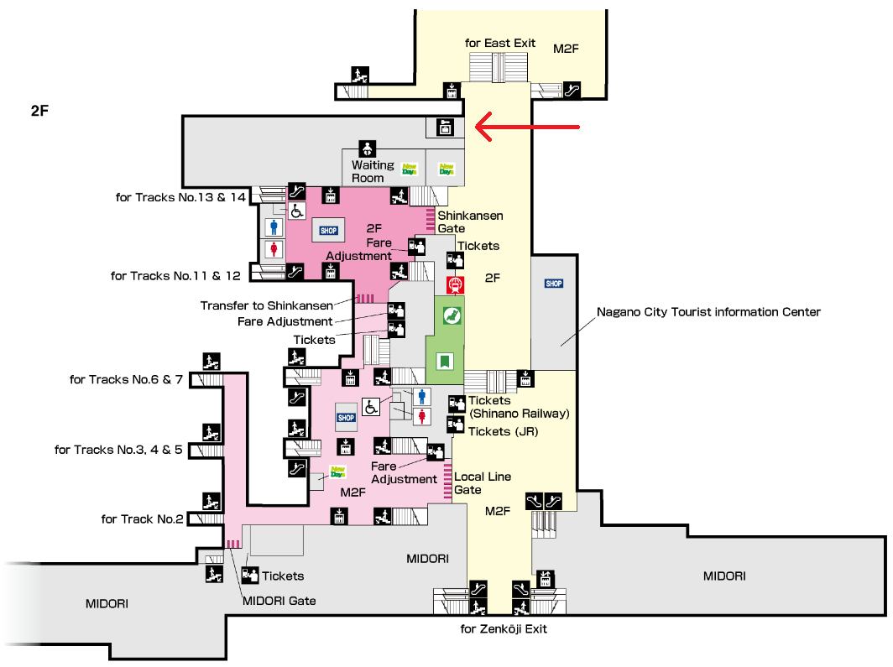
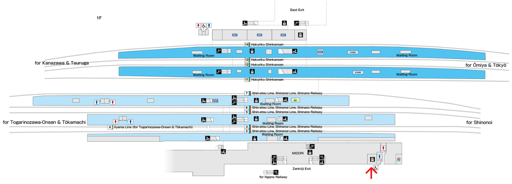
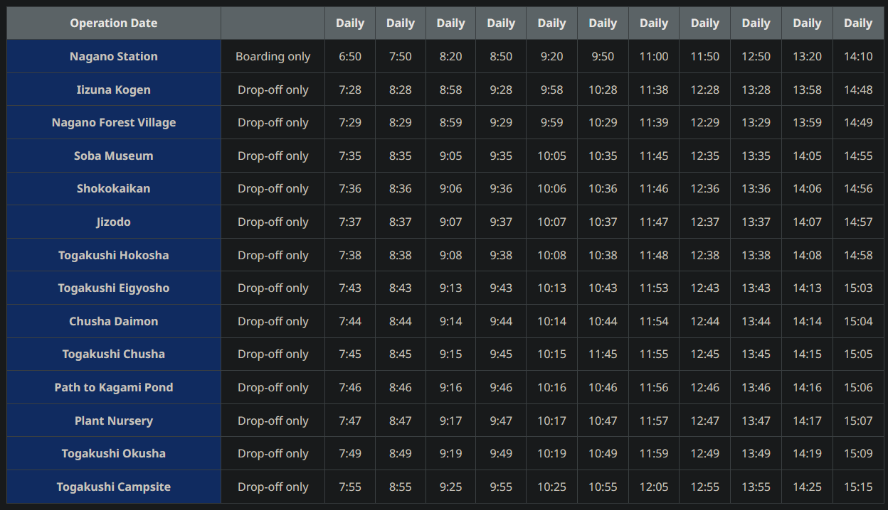
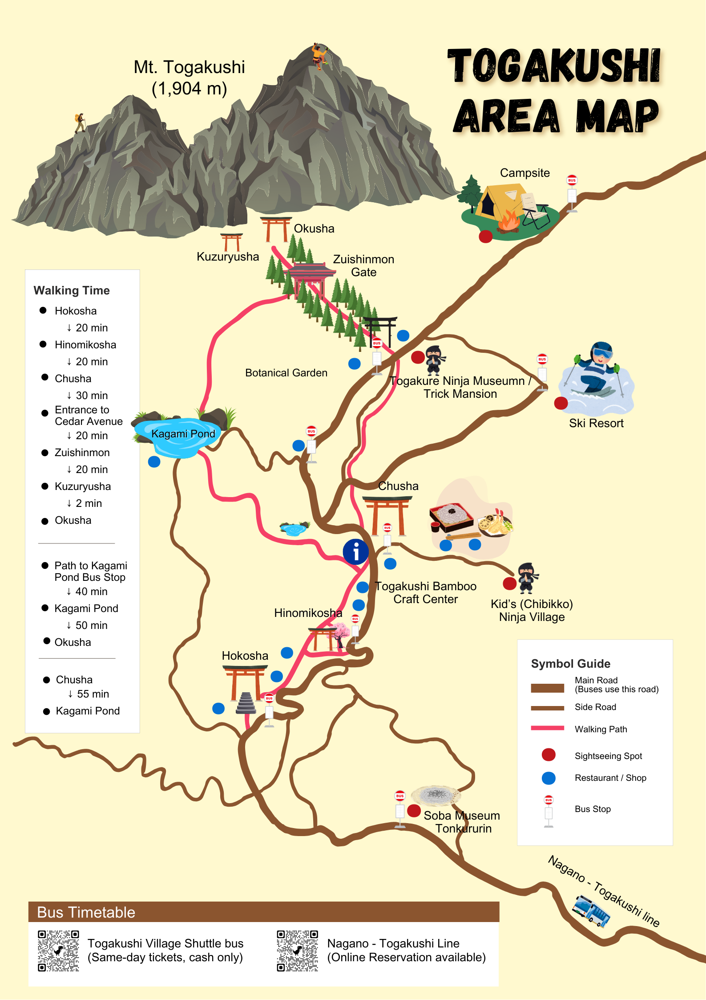
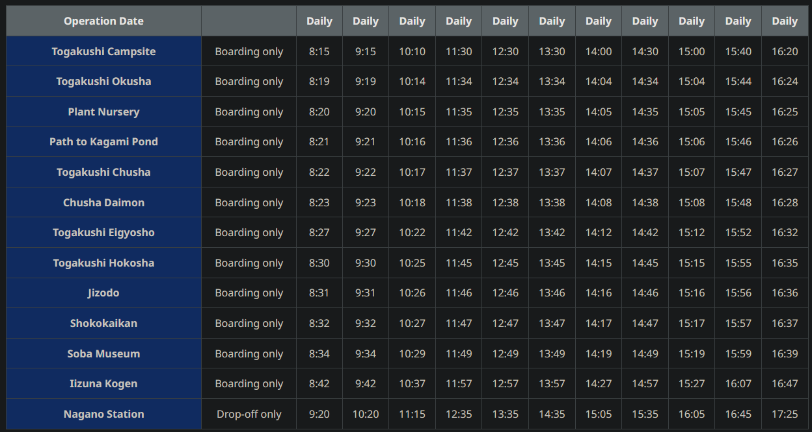

# 2026-10-20 — Tuesday

title: Togakushi Tuesday
subtitle: Shinjuku → Togakushi
index: Togakushi
footer: Times use Japan Standard Time. Check live transport, weather, trail, and bear information before travel.

## Before leaving

- [ ] Pack at least **10 × ¥100** and **2 × ¥500** coins.
- [ ] Reserve a Nagano Station 2F locker at [Multi eCube](https://multiecube.com/en).
- [ ] Pack bear spray and know how to use it.
- [ ] Check current bear sightings in Kumamap before leaving.
- [ ] Check Kumamap again before beginning the trail.

## Plan

### Shinjuku → Ueno

**05:41–06:08** · Train · hard departure

> Yamanote Line from platform 15 toward Ueno and Ikebukuro.

Take the **Yamanote Line from platform 15**, toward Ueno/Ikebukuro.

- Board toward the **middle/front** of the train.
- Earlier option: depart **05:34** and arrive 05:59.

[Route reference](https://japantravel.navitime.com/en/area/jp/route/result/?start=00004254&goalCode=02301-2000103&start_name=Shinjuku&goal_name=Togakushi%20Shrine%20Okusha%20(Main%20Shrine)&cid=&from=route_result_search_box&date_time=2026-10-20T18%3A34&search_time_mode=first-operation)

### Ueno → Nagano

**06:22–07:36** · Shinkansen · hard departure

> Kagayaki Shinkansen toward Tsuruga. Get off at Nagano.

Take the **Kagayaki Shinkansen 501 toward Tsuruga** and get off at Nagano.

- car 4 seat 18E on the left

### Store the backpack

**07:36–07:50** · Nagano Station · 14 minutes

> Try East Exit 2F first. The bus leaves from stop 7 at 07:50.

!!! warning **Move quickly:** only 14 minutes are planned before the bus departure.

1. **East Exit, 2F** — near Shinkansen gates and NewDays.
2. **Zenkoji Exit, 1F** — near the taxi area outside.
3. **Nagano Electric Railway, B1F** — by its underground gates.

### Nagano → Togakushi Okusha

**07:50–08:49** · Bus · stop 7 · hard departure

> Zenkoji Exit, left across the street, Alpico bus stop 7. Get off at stop 12.

Leave via **Zenkoji Exit**, turn left, cross the street, and walk to **Alpico bus stop 7**.

Take the Togakushi bus and leave at **Togakushi Okusha, stop 12**.

- The bus reservation is in the email.
- No reservation is required if seats are available.
- Pay with contactless **VISA** or cash.
- **Suica and other IC cards are not accepted.**

****
[Official timetable](https://visit-nagano.alpico.co.jp/timetable/nagano-togakushi-green)

### Walk to Okusha Shrine

**08:49–09:35** · Walking · approximately 45 min

> Walk from Togakushi Okusha bus stop to the shrine. Allow about 45 minutes.

Walk from the Togakushi Okusha bus stop to **Okusha Shrine**.

!!! warning Before setting out, check trail conditions, daylight, weather, and bear reports.

****

### Okusha → Kagami Pond

**09:35–10:35** · 30 min walk · 30 min visit

> Walk about 30 minutes, then spend 30 minutes at Kagami Pond.

- **09:35–10:05:** walk from Okusha to Kagami Pond.
- **10:05–10:35:** spend 30 minutes at the pond.

****
[AllTrails route 1](https://www.alltrails.com/trail/japan/nagano/togakushi-winter-trekking-route)
[AllTrails route 2](https://www.alltrails.com/trail/japan/nagano/togakushi-land-of-reverence-for-mountains-course)

### Kagami Pond → Chusha

**10:35–11:30** · Walking · approximately 55 min

> Walk to Togakushi Chusha, allowing approximately 55 minutes.

Walk from Kagami Pond to **Togakushi Chusha**.

****

### Lunch at Uzuraya

**11:30–14:00** · Meal and relaxed break

> Eat and take a relaxed break. Leave enough time to reach Chusha Daimon for the 14:08 bus.

Eat at **Uzuraya**. If its line is too long, use one of the alternatives.

!!! warning The return bus leaves Chusha Daimon at **14:08**.

**[Uzuraya map](https://maps.app.goo.gl/JwmZu6EXf9NtNQEZ9)**
[Alternative 1](https://maps.app.goo.gl/b3c8ZST9tHqzJYir5)
[Lamp Cafe](https://maps.app.goo.gl/arMkZ9eZzbrD7tzu5)

### Togakushi → Nagano

**14:08–15:05** · Bus · Chusha Daimon · hard departure

> Board at Chusha Daimon at 14:08 and ride back to Nagano Station.

Board the Alpico bus at **Chusha Daimon at 14:08** and ride to Nagano Station.

****
[Official timetable](https://visit-nagano.alpico.co.jp/timetable/nagano-togakushi-green)

### Nagano Station → Zenkoji

**15:05–15:30** · Walking · approximately 25 min

> Walk from Nagano Station to Zenkoji, allowing approximately 25 minutes.

Walk from Nagano Station to **Zenkoji**.

### Visit Zenkoji

**15:30–16:15** · Temple visit · 45 minutes

> Spend 45 minutes at Zenkoji.

Spend 45 minutes at **Zenkoji**.

**[Zenkoji location](https://www.google.com/maps/search/?api=1&query=Zenkoji+Temple+Nagano)**

### Zenkoji → Nagano Station

**16:15–16:40** · Walking · approximately 25 min

> Walk back to Nagano Station and collect the backpack.

Walk back to **Nagano Station**, allowing approximately 25 minutes.

- Pick up the backpack stored earlier at Nagano Station.

**[Nagano Station location](https://www.google.com/maps/search/?api=1&query=Nagano+Station)**

### Nagano → Matsumoto

**17:00–17:51** · Shinano Limited Express 22 · platform 6 · hard departure

> Shinano Limited Express 22 from platform 6 to Matsumoto.

Take the **Shinano Limited Express 22** from **platform 6** to Matsumoto.

- Buy a **physical ticket** before boarding.

### Pick up rental car

**17:51–18:20** · Nissan Rent-A-Car · Matsumoto Station

> Pick up the rental car from Nissan Rent-A-Car Matsumoto Station.

Pick up the rental car from **Nissan Rent-A-Car Matsumoto Station**.

**[Nissan Rent-A-Car location](https://www.google.com/maps/search/?api=1&query=Nissan+Rent-A-Car+Matsumoto+Station)**

### Matsumoto Station → Onyado Nono Matsumoto

**18:20–18:30** · Car · 10 minutes

> Drive from Matsumoto Station to Onyado Nono Matsumoto Natural Hot Spring.

Drive from Matsumoto Station to **Onyado Nono Matsumoto Natural Hot Spring**.

**[Hotel location](https://www.google.com/maps/search/?api=1&query=Onyado+Nono+Matsumoto+Natural+Hot+Spring)**

## Quick references

- 
- 
- 
- 
- 
- [Bus tickets · Manage reservation](https://www.highwaybus.com/gp/inbound/inbRsvSearch)
- [Local shuttle · Official timetable](https://visit-nagano.alpico.co.jp/timetable/togakushi-shuttlebus)
- [Five shrines · Area information](https://visit-nagano.alpico.co.jp/travelog/post/hiking-the-5-shrines-trail-in-togakushi/)
