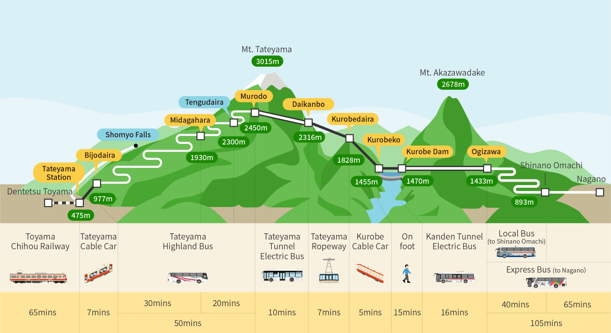

# 2026-10-24 — Saturday

title: Alpine Route Saturday
subtitle: Shinano Omachi → Kanazawa
index: Alpine Route → Kanazawa
footer: Times use Japan Standard Time. The hotel walk from Korinbo will be refined if needed.

## Before leaving

- [ ] Check Alpine Route operating status and weather.
- [ ] Pack food and water for the crossing.

## Plan

### Shinano Omachi → Ogizawa

**06:15–06:55** · Alpico Kotsu bus · hard departure

> Take the Alpico Kotsu Ogizawa Line bus to Ogizawa.

Take the **Alpico Kotsu Ogizawa Line bus** from Shinano Omachi to **Ogizawa**.

- Departure: **06:15**
- Arrival: **06:55**
- Arrive early enough to find the stop and board without rushing.

### Tateyama Kurobe Alpine Route

**07:30–17:30** · Route crossing · 10 hours · hard start

> Cross the Alpine Route from Ogizawa toward the Tateyama side. Allow 10 hours.

Begin the **Tateyama Kurobe Alpine Route** from Ogizawa at **07:30**. For now, allow **10 hours** for the complete route.

**[Open timetable](../assets/2026-10-24_SAT/tateyama-kurobe-alpine-route-timetable-2026.pdf)**

### Dentetsu Toyama → Kanazawa Station

**17:57–18:20** · Hakutaka 569 · platform 13 · hard departure

> Hakutaka 569 from Dentetsu Toyama platform 13 to Kanazawa Station.

Board the **Hakutaka 569 Shinkansen** at **Dentetsu Toyama, platform 13**, and ride to **Kanazawa Station**.

- Departure: **17:57**
- Arrival: **18:20**

### Kanazawa Station East Exit → Korinbo

**18:36–18:46** · Bus · 10Ban Noriba · 4 stops · hard departure

> Take the bus from 10Ban Noriba toward Minabe Shako. Get off at Korinbo after 4 stops.

From **Kanazawa Station East Exit**, go to **10Ban Noriba** and take the bus toward **Minabe Shako**.

- Depart at **18:36**.
- Count **4 stops** and get off at **Korinbo** at **18:46**.

Continue from the Korinbo stop to **KOKO HOTEL Premier Kanazawa Korinbo**.

**[Hotel location](https://www.google.com/maps/search/?api=1&query=KOKO+HOTEL+Premier+Kanazawa+Korinbo)**

## Quick references

- [Alpine Route timetable · Open PDF](../assets/2026-10-24_SAT/tateyama-kurobe-alpine-route-timetable-2026.pdf)
- 
- [Alpine Route · Official site](https://www.alpen-route.com/en/)
- [KOKO HOTEL Korinbo · Open in Maps](https://www.google.com/maps/search/?api=1&query=KOKO+HOTEL+Premier+Kanazawa+Korinbo)
