# Togakushi attractions

Short reference guide with three locally downloaded images for each attraction. Image credits and original source pages are listed beneath each image.

Images were collected on October 14, 2026. Check the original source pages for current usage rights before republishing.

## Togakushi Shrine complex

A sacred mountain-shrine complex consisting of five shrines: Hoko-sha, Hino-miko-sha, Chusha, Kuzuryusha, and Okusha. The shrines combine mythology, cedar forests, and mountain pilgrimage routes.

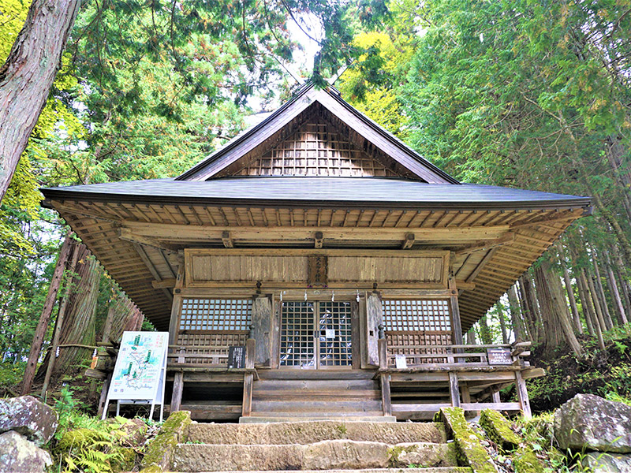

Source: [Visiting the Five Shrines of Togakushi - Historic Roads and Trails -  History and Culture - Trip Ideas - Go! Nagano](https://db.go-nagano.net/en/theme/id=19814)

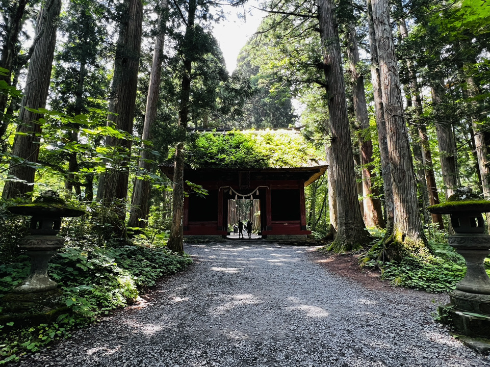

Source: [Explore five shrines and take time to reflect on yourself - Trip.com Nagano  City](https://www.trip.com/moments/detail/nagano-city-1446601-142640171/)

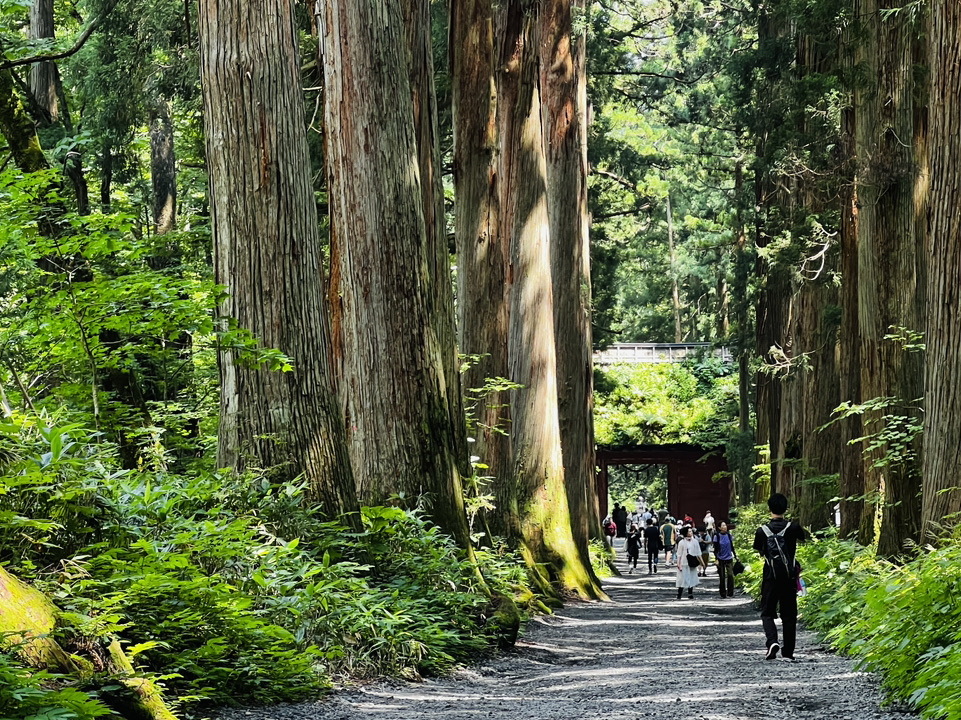

Source: [Explore five shrines and take time to reflect on yourself - Trip.com Nagano  City](https://www.trip.com/moments/detail/nagano-city-1446601-142640171/)

---

## Ancient cedar avenue

The celebrated approach to Okusha is lined with towering, centuries-old cedars. It is one of Togakushi's most atmospheric walks and forms the central approach to the upper shrine.

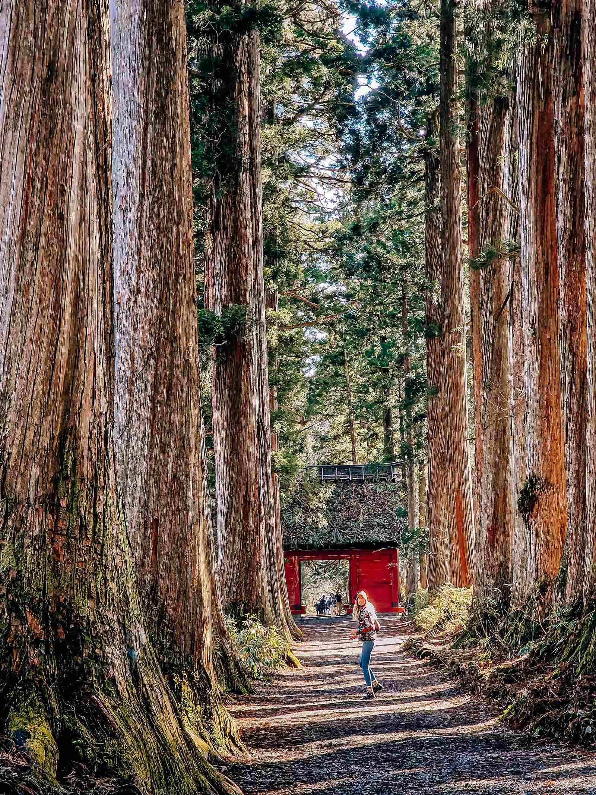

Source: [Togakushi Hike: A guide to the Togakushi shrine walk and how to get there - Helena Bradbury](https://www.helenabradbury.com/blog-1/togakushi-shrine-hike-guide-japan)

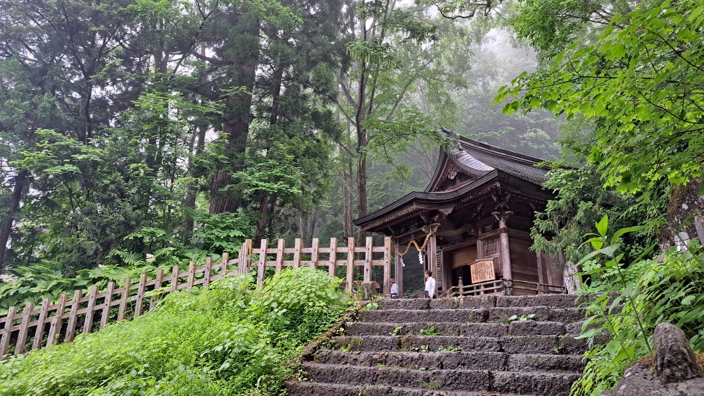

Source: [Togakushi Okusha](https://www.snowmonkeyresorts.com/activities/togakushi-shrine-okusha/)

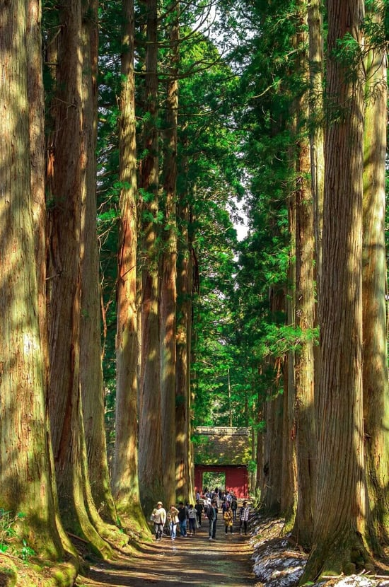

Source: [Togakushi Half-Day Itinerary: Explore the Five Shrines and Cedar Avenue  (Map Included) - Travelog - Bus services, tours and travel in Nagano -  ALPICO GROUP Official Website](https://visit-nagano.alpico.co.jp/travelog/post/hiking-the-5-shrines-trail-in-togakushi/)

---

## Kagami-ike Pond

A mirror-like mountain pond known for reflections of the surrounding peaks. It is an easy scenic stop and especially attractive during autumn foliage.

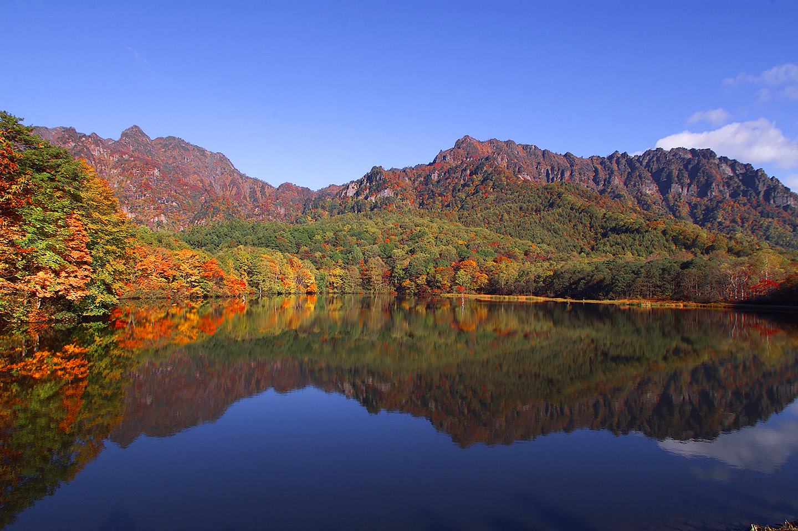

Source: [Kagami Pond Travel Guides (Nagano Nagano-shi Togakushi)- Japan Travel by  NAVITIME - Guides, Transit Search and Itinerary Planner](https://japantravel.navitime.com/en/area/jp/spot/02301-2000191/)

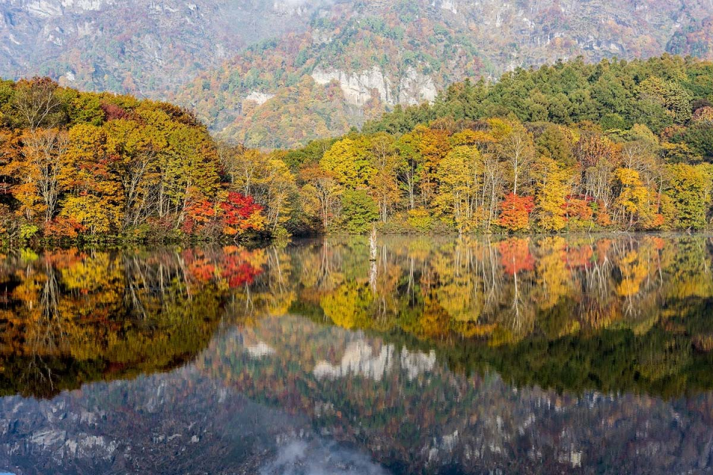

Source: [Togakushi-kogen Highlands and Lake Kagami(Mirror Pond)](https://zekkeijapan.com/spot/index/886/)

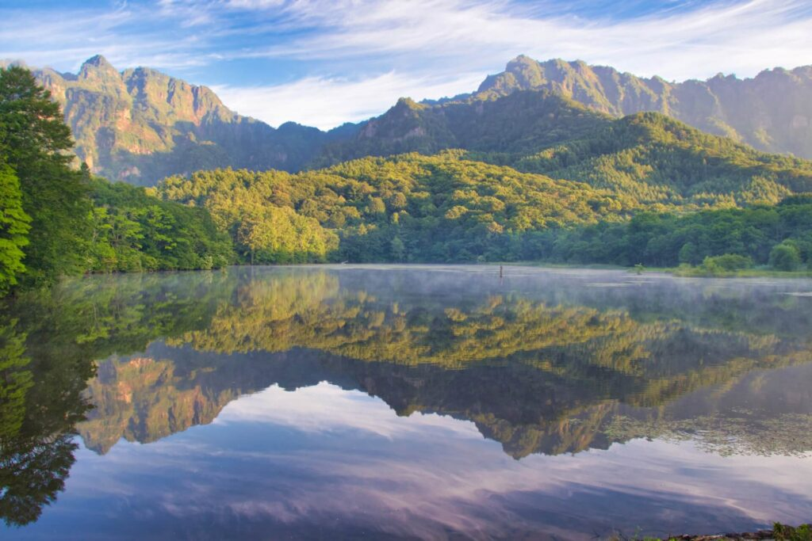

Source: [Kagami-ike (Lake Kagami) - Snow Monkey Resorts](https://www.snowmonkeyresorts.com/activities/lake-kagami-ike/)

---

## Togakushi Forest Botanical Garden

A peaceful woodland garden with walking paths, wetland habitats, ponds, and native alpine plants near the shrine area.

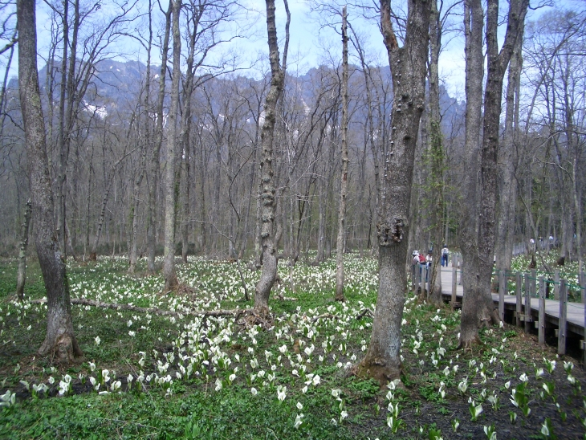

Source: [Togakushi Forest Botanical Garden - NAGANO CITY OFFICIAL TRAVEL GUIDE](http://en.nagano-cvb.or.jp/modules/sightseeing/page/29)

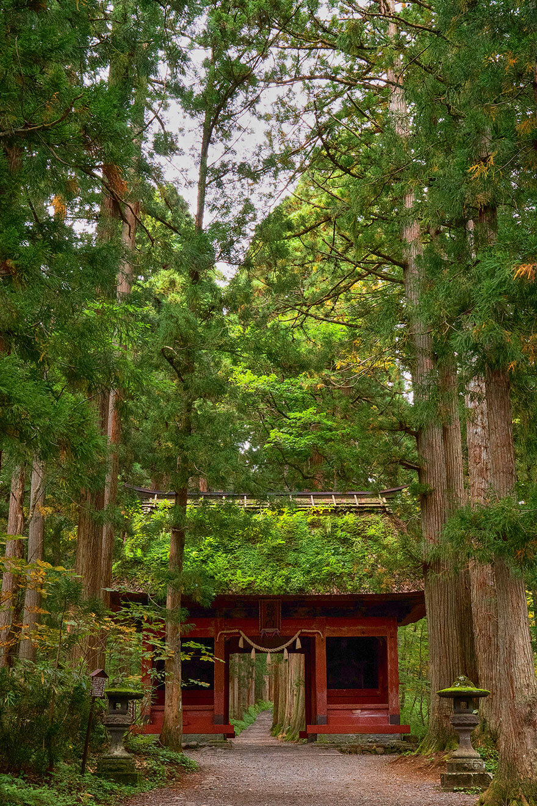

Source: [Togakushi Forest Botanical Garden](https://en.my10.jp/spot/togakushi-forest-botanical-garden.php)

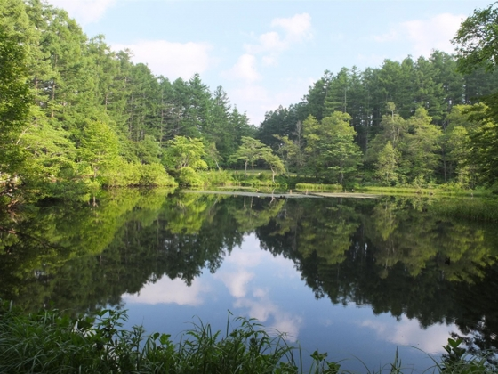

Source: [Togakushi Forest Botanical Garden (Midorigaike Pond) - Nagano - Japan Location Database](https://jl-db.nfaj.go.jp/en/location/200400009/)

---

## Togakushi Ninja Museum and Ninja House

A small museum dedicated to local ninja traditions, with historical displays, weapons, and a maze-like trick house that is particularly popular with families.

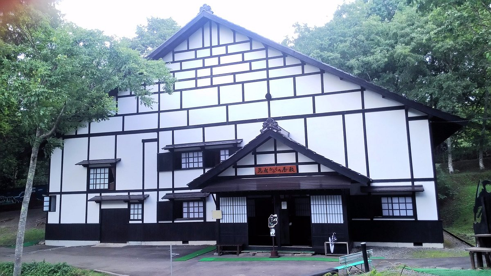

Source: [Togakushi Folk Museum Togakushi Ninja Museum - All You SHOULD Know Before  Going (2026 Reviews)](https://www.tripadvisor.com/Attraction_Review-g298565-d2316012-Reviews-Togakushi_Folk_Museum_Togakushi_Ninja_Museum-Nagano_Nagano_Prefecture_Koshinetsu_.html)

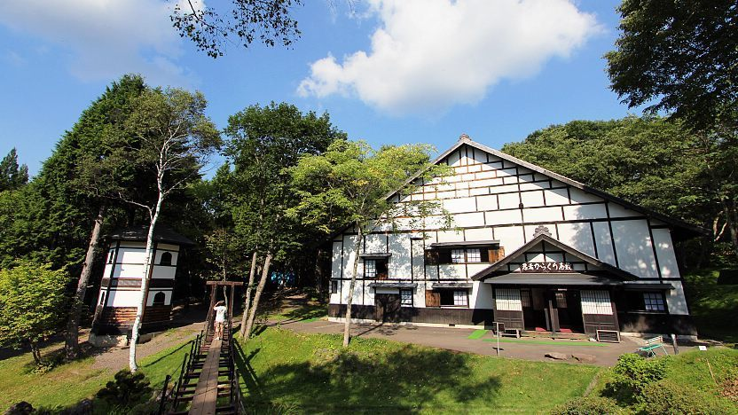

Source: [Togakure Ninpo Museum (Togakure Ninja Museum) - Nagano Travel](https://www.japan-guide.com/e/e6006.html)

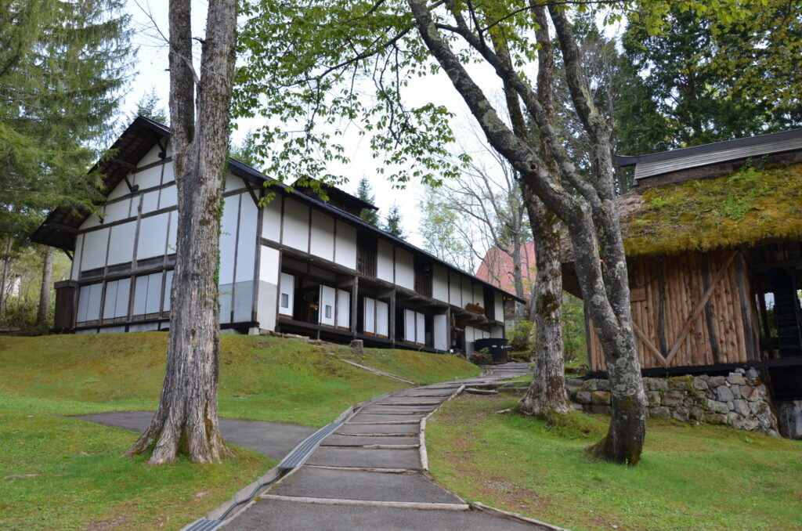

Source: [Togakushi Ninja & Folk Museum inc. Ninja House - Snow Monkey Resorts](https://www.snowmonkeyresorts.com/activities/experience-togakushi-ninja-house/)

---

## Togakushi Folk Museum

A cultural museum preserving local buildings, tools, household objects, and displays about life in the Togakushi mountain settlement.

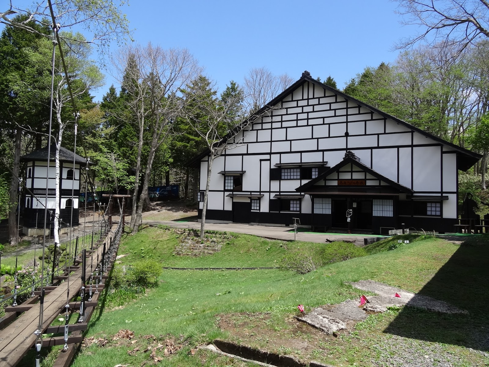

Source: [WEBS OF SIGNIFICANCE: Surprises await at the ninja-themed Togakushi  Minzokukan](http://webs-of-significance.blogspot.com/2016/05/surprises-await-at-ninja-themed.html)

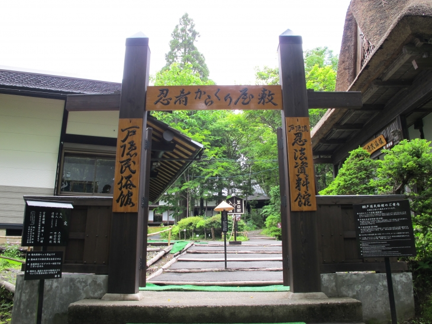

Source: [Togakushi Folk Museum, Togakure Ninja Museum, Ninja Trick Mansion - NAGANO  CITY OFFICIAL TRAVEL GUIDE](http://en.nagano-cvb.or.jp/modules/sightseeing/page/19)

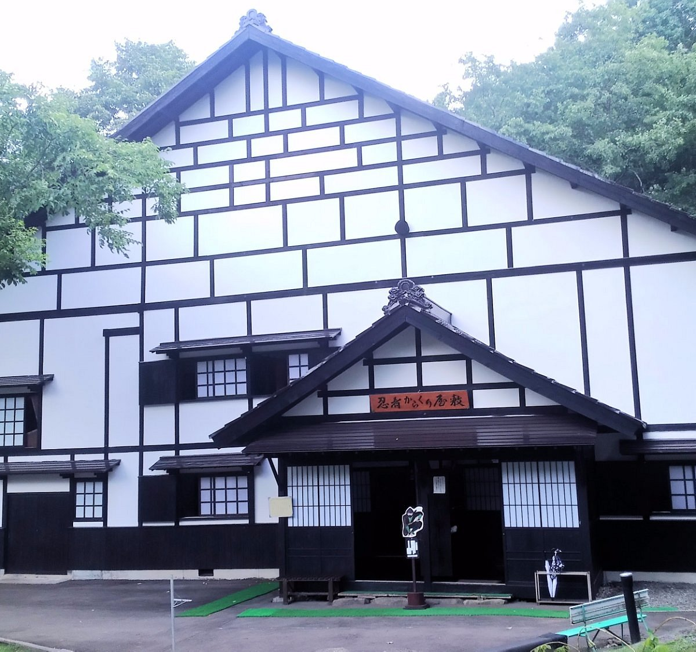

Source: [Togakushi Folk Museum Togakushi Ninja Museum - All You SHOULD Know Before  Going (2026 Reviews)](https://www.tripadvisor.com/Attraction_Review-g298565-d2316012-Reviews-Togakushi_Folk_Museum_Togakushi_Ninja_Museum-Nagano_Nagano_Prefecture_Koshinetsu_.html)

---

## Togakushi soba

Togakushi is famous for distinctive hand-made soba served at long-established restaurants around Chusha and the other shrine areas.

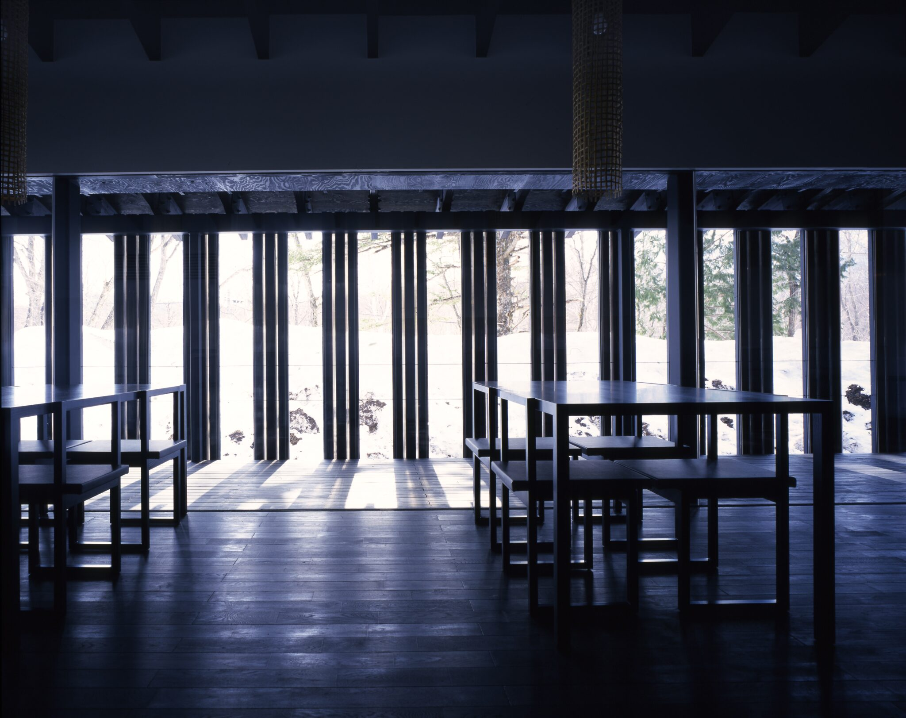

Source: [Soba Restaurant at Togakushi Shrine - Kengo Kuma and Associates](https://kkaa.co.jp/en/project/soba-restaurant-at-togakushi-shrine/)

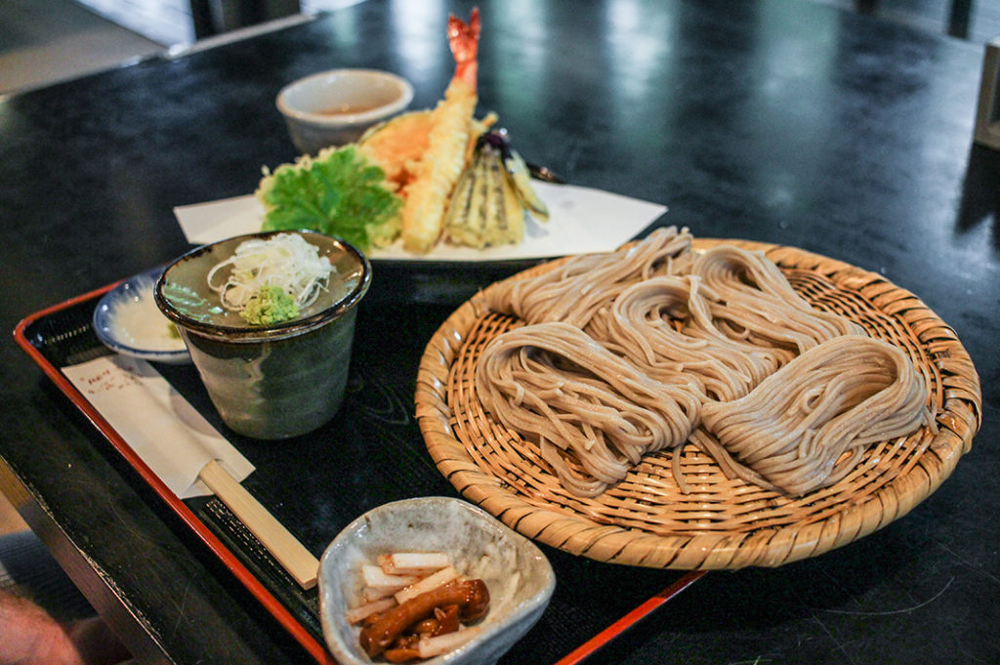

Source: [Togakushi Soba: One Of Nagano's Unique Varieties - Japan Journeys](https://japanjourneys.jp/nagano/lifestyle/dining/togakushi-soba/)

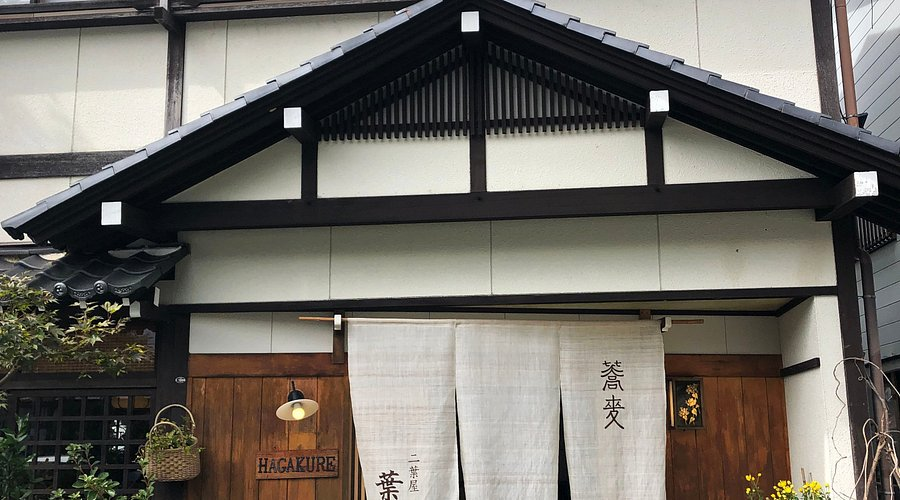

Source: [TOGAKUSHI SOBA FUTABAYA, Nagano - Restaurant Reviews, Photos & Phone Number  - Tripadvisor](https://www.tripadvisor.com/Restaurant_Review-g298565-d5488203-Reviews-Togakushi_Soba_Futabaya-Nagano_Nagano_Prefecture_Koshinetsu_Chubu.html)

---

## Mount Togakushi hiking

Mountain trails offer dramatic views and a more strenuous experience beyond the shrine walk. Conditions can change quickly, so check weather and trail status before setting out.

Source: [Togakushi Hike: A guide to the Togakushi shrine walk and how to get there - Helena Bradbury](https://www.helenabradbury.com/blog-1/togakushi-shrine-hike-guide-japan)

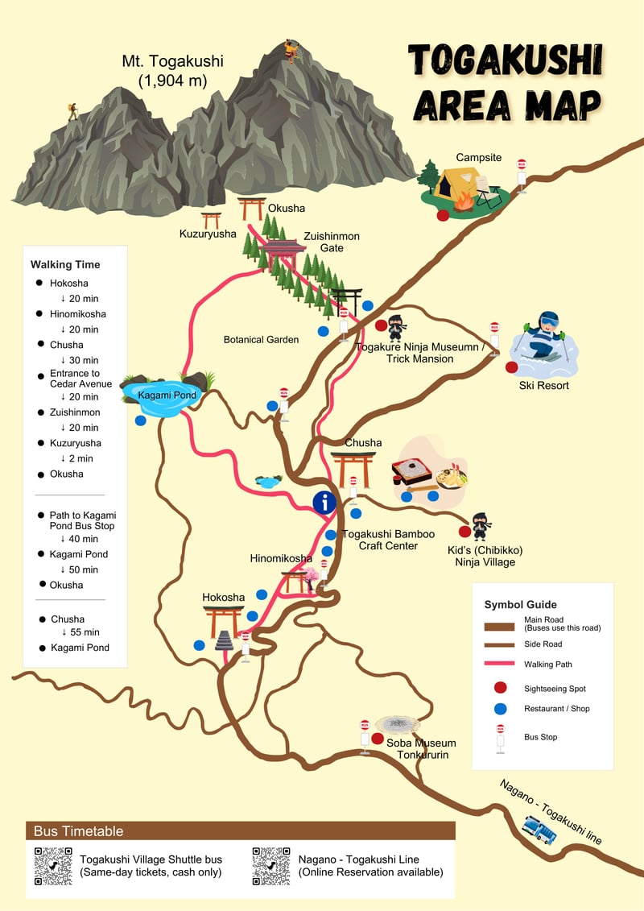

Source: [Togakushi Half-Day Itinerary: Explore the Five Shrines and Cedar Avenue  (Map Included) - Travelog - Bus services, tours and travel in Nagano -  ALPICO GROUP Official Website](https://visit-nagano.alpico.co.jp/travelog/post/hiking-the-5-shrines-trail-in-togakushi/)

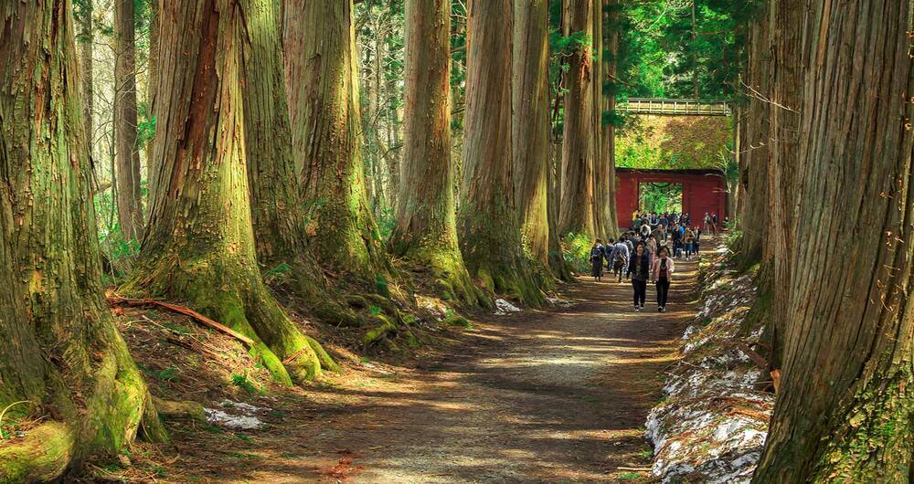

Source: [Togakushi Half-Day Itinerary: Explore the Five Shrines and Cedar Avenue  (Map Included) - Travelog - Bus services, tours and travel in Nagano -  ALPICO GROUP Official Website](https://visit-nagano.alpico.co.jp/travelog/post/hiking-the-5-shrines-trail-in-togakushi/)

---

## Togakushi woodland trails

Shorter forest and nature walks connect the shrine, botanical garden, ponds, and highland scenery, making them a gentler alternative to the more demanding mountain routes.

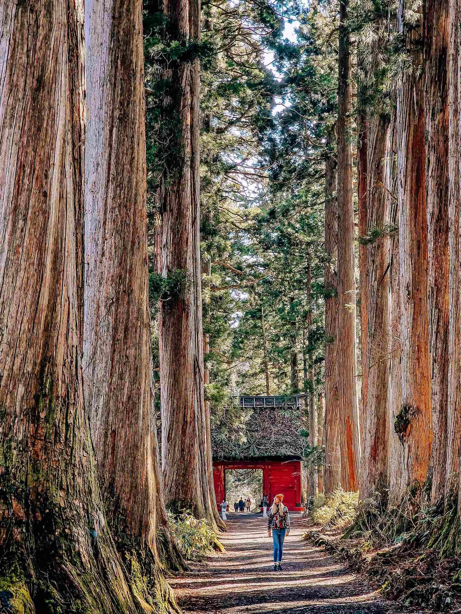

Source: [Togakushi Hike: A guide to the Togakushi shrine walk and how to get there - Helena Bradbury](https://www.helenabradbury.com/blog-1/togakushi-shrine-hike-guide-japan)

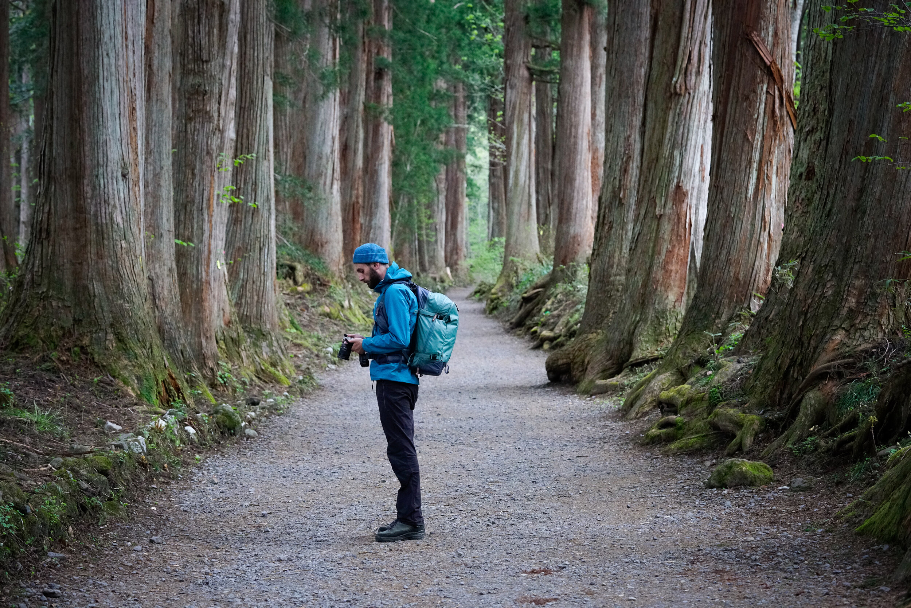

Source: [STORY TIME: TOGAKUSHI-JINJA SHRINE - HIKING IN JAPAN - Shimoda US](https://shimodadesigns.com/journal/story-time-togakushijinja-shrine-hiking-in-japan/?srsltid=AU7gw4V1ijG9YKhd11vRsPNrQgp_wtcn5NWQVQE2LoVN-XAl1IC-L7gM)

Source: [Togakushi Half-Day Itinerary: Explore the Five Shrines and Cedar Avenue  (Map Included) - Travelog - Bus services, tours and travel in Nagano -  ALPICO GROUP Official Website](https://visit-nagano.alpico.co.jp/travelog/post/hiking-the-5-shrines-trail-in-togakushi/)

---

## Togakushi Ski Resort

A winter ski area with alpine scenery and downhill terrain. In October it is primarily a scenic mountain destination; ski operations are seasonal.

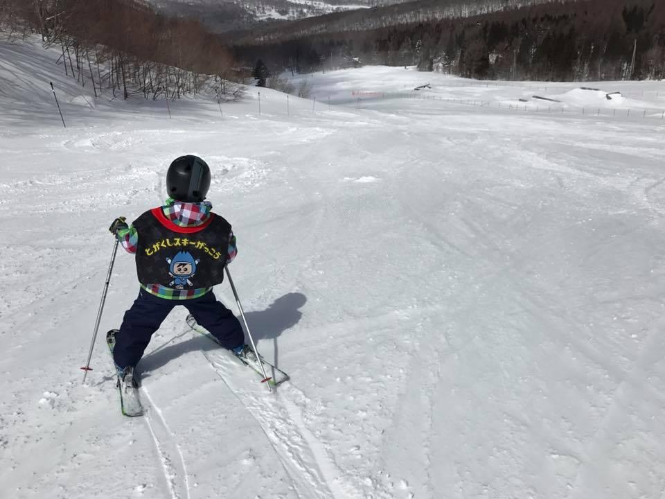

Source: [Togakushi Ski School / resort image](https://www.togakushi-ss.com/)

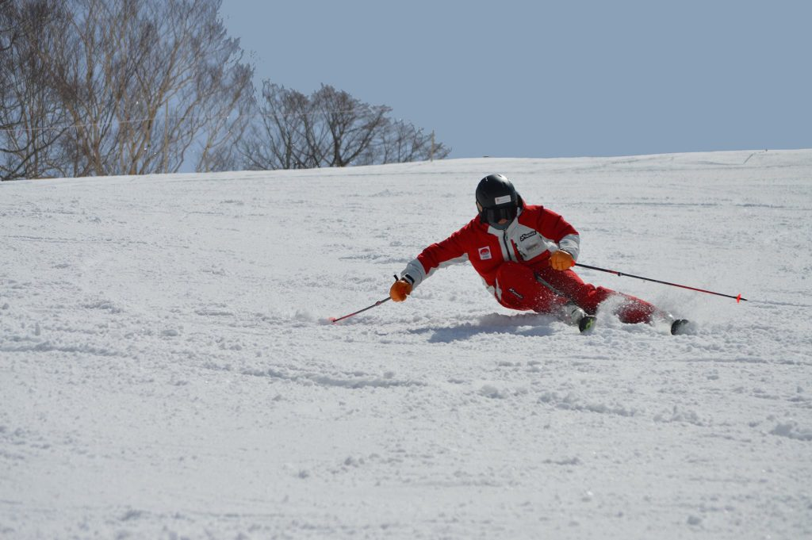

Source: [Togakushi Ski School / resort image](https://www.togakushi-ss.com/)

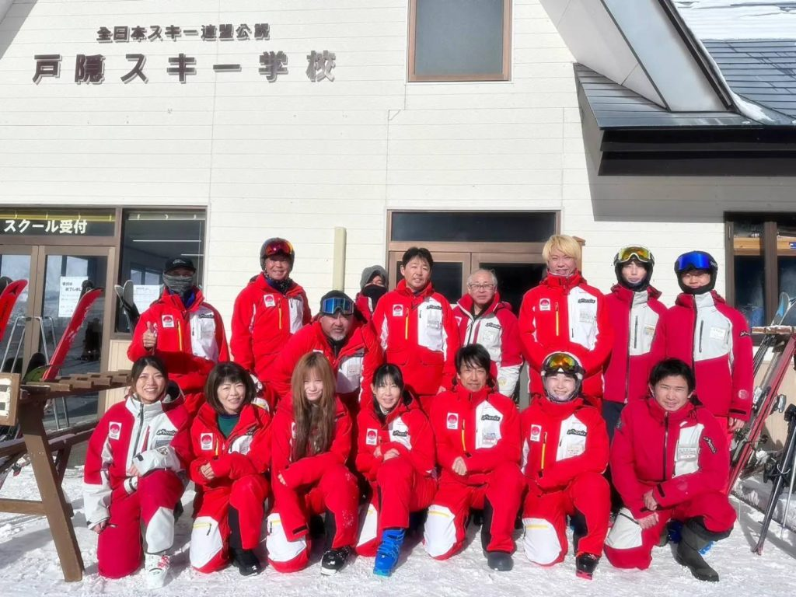

Source: [Togakushi Ski School / resort image](https://www.togakushi-ss.com/)

---

